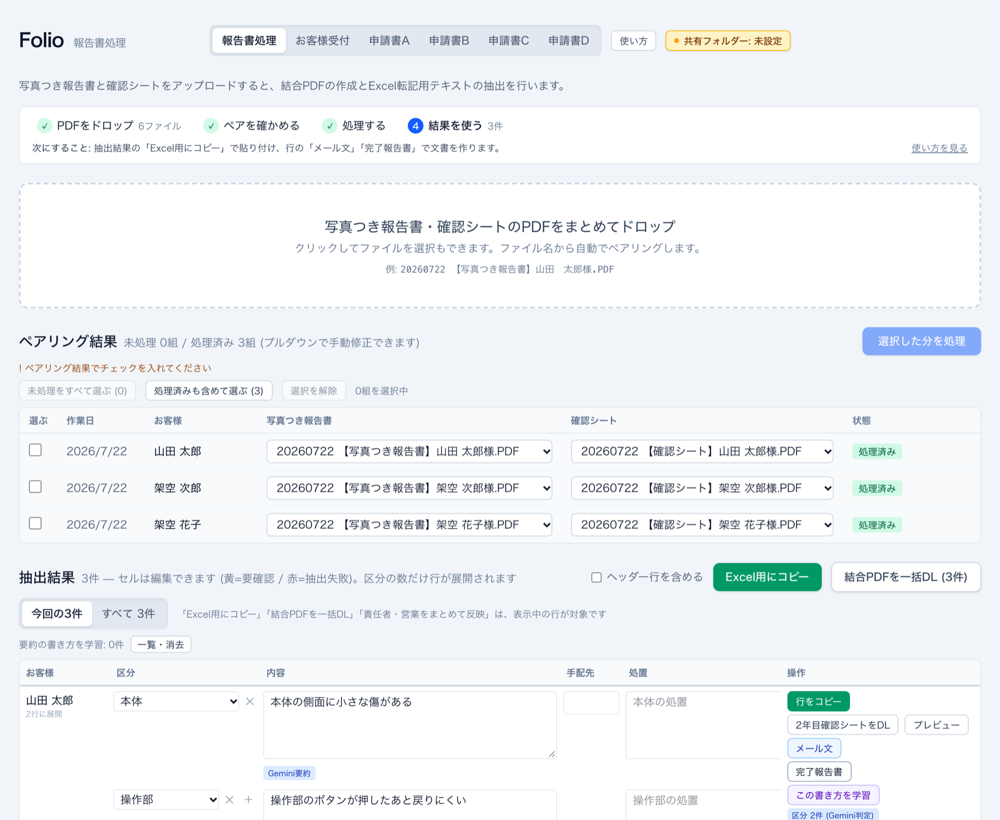
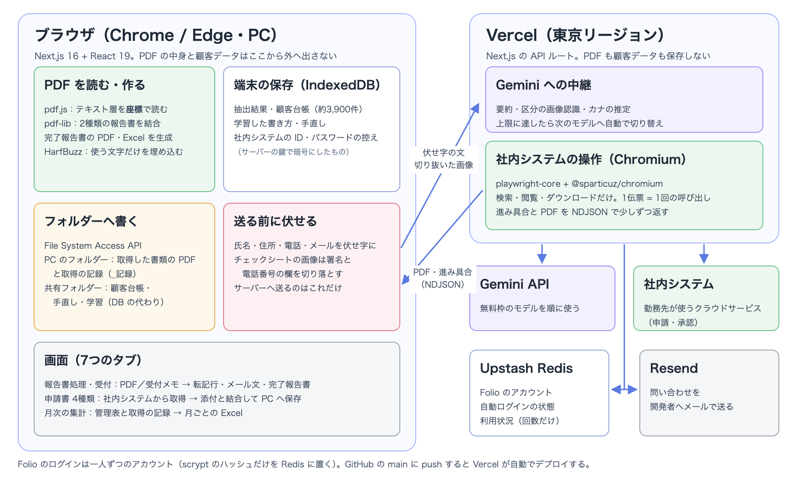
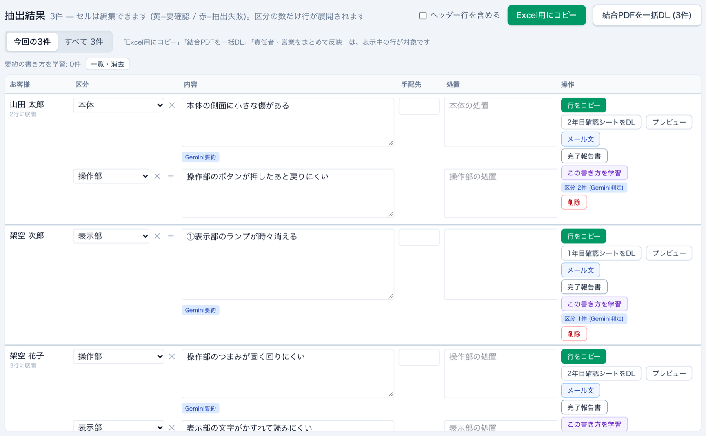
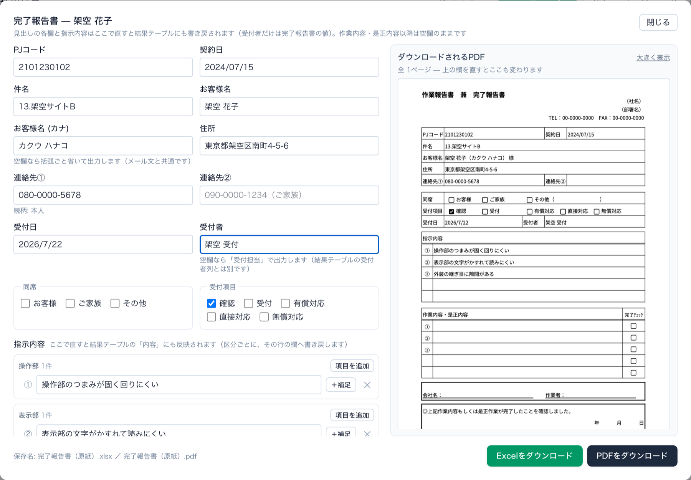
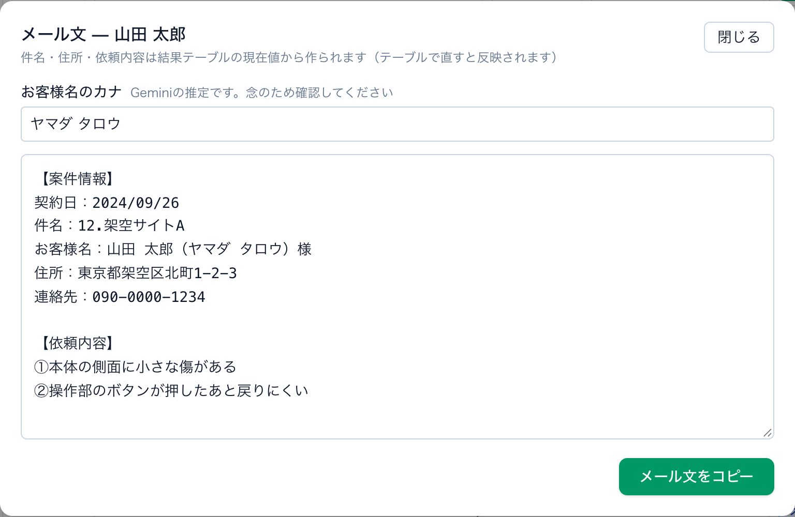
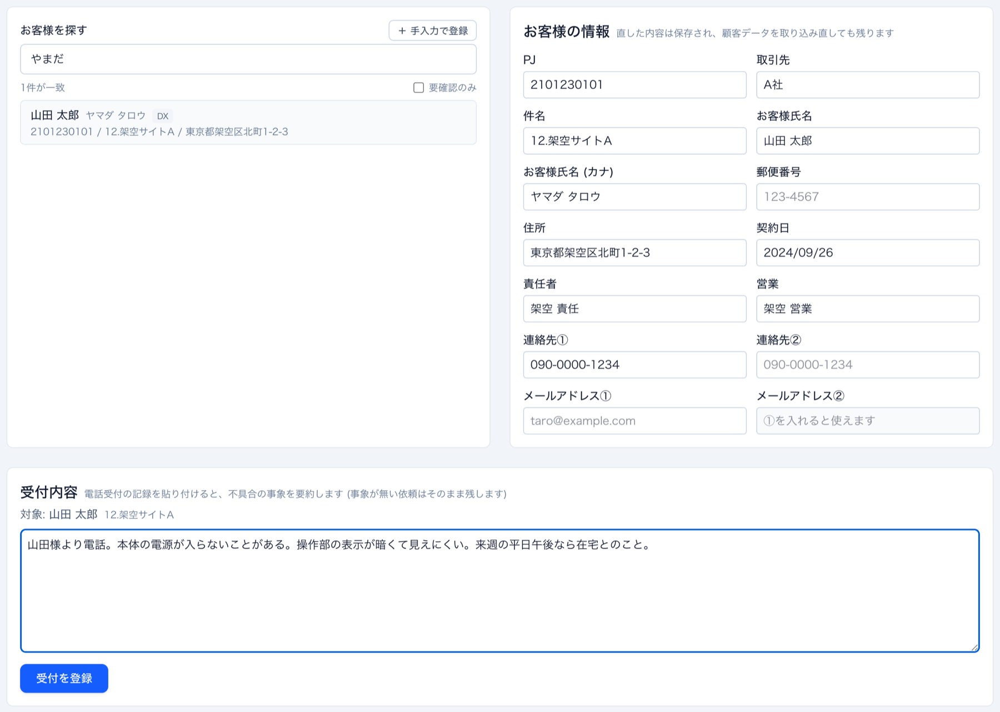
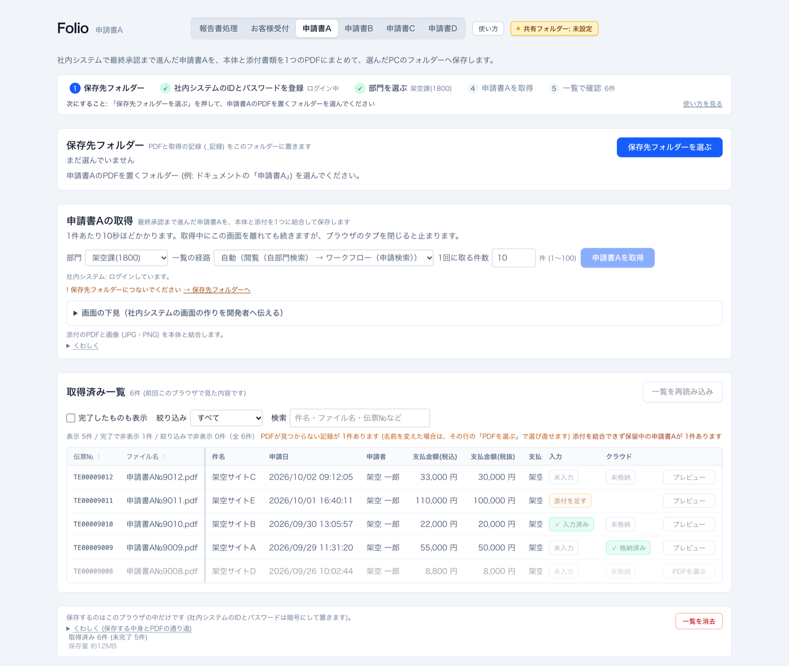
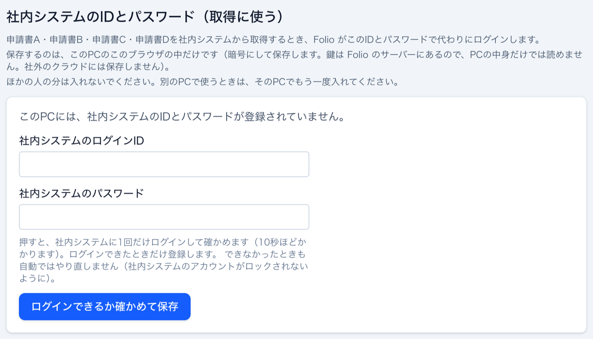

<h1 align="center">Folio — 報告書の処理を自動化する業務アプリ<br>作品説明資料</h1>

勤務先の部署で発生する書類の仕事をまとめて引き受ける、**勤務先の業務で実際に使っている Web アプリケーション**である。届いた報告書（PDF）を入れると、Excel へ貼る転記行・結合 PDF・依頼メールの文面・完了報告書ができる。勤務先が使っている申請・承認のクラウドサービス（以下「社内システム」）からは、最終承認まで進んだ申請書の PDF と添付を取得して1つにまとめ、PC のフォルダーへ保存する。**PDF の中身とお客様の個人情報はブラウザの外へ出さない**作りにした。企画・設計・デプロイ・運用を一人で行い、自分ともう1人が業務で使っている。

| 項目 | 内容 |
|---|---|
| 氏名 | 木村 大暉 |
| 区分 | 個人開発（Webアプリケーション／勤務先の業務で2人が使用・本番で運用中） |
| ソースコード | 非公開（勤務先の業務の情報を含むため）。ご希望があれば、閲覧用に GitHub のリポジトリへ招待します。資料・画面写真・動画は紹介用のリポジトリ <https://github.com/mocaluna0117/folio> に置いている |
| 実行ファイル（bin） | なし（Webアプリのため exe は無い）。動画と「9. 動作確認方法」で確認できる |
| 動作紹介動画 | <https://github.com/mocaluna0117/folio/blob/main/folio-demo.mp4>（約1分15秒） |
| 本番環境 | お客様の個人情報と社内の書類を扱うため、アカウントを発行した人だけが使える（公開不可。動画と画面写真で確認いただけます） |

> 本資料の画面写真と動画は、手元の開発サーバーで、**架空の報告書 PDF（本物と同じ位置に文字を置いてプログラムで作ったもの）・架空のお客様・架空の申請書**を使って撮影した。勤務先の業務が分かる語（タブ名・書類名・項目名・区分名・取引先名・連携先の名前など）は、**撮影のときだけ、ブラウザに届く JS と画面の文字を一般的な語に置き換えた**（例: 申請書A〜D、区分01〜、社内システム）。AI（Gemini）の応答は撮影用の固定の応答に置き換えた。それ以外の動作は本番と同じコードである。

<p align="center">
  
</p>

---

## 1. 制作意図

勤務先の部署では、お客様の対応のたびに、同じ情報を何度も書き写していた。

- **報告書の内容を Excel へ1件ずつ手で写していた。** 届いた写真つきの報告書から、契約番号・件名・お客様名・住所・日付などを、転記先の Excel（24列）へ写す。不具合が複数あれば区分ごとに行を分け、内容を要約して書く
- **同じ内容から、別の書類をまた手で作っていた。** 2種類の報告書を1つの PDF にまとめる、依頼メールの文面を書く、社内様式の完了報告書を作る、のどれもが転記の繰り返しだった
- **申請書の PDF を1件ずつ取りに行っていた。** 社内システムで最終承認まで進んだ申請書を開き、本体の PDF と添付を取り、1つにまとめて保存する

そこで次の3つを目標にした。

- **PDF を入れるだけで、転記行・結合 PDF・メール文・完了報告書がそろう**こと。読み取れなかった所は推測で埋めず、色で知らせて人が直せること
- **お客様の個人情報を外へ出さない**こと。PDF の中身と顧客データはブラウザの中で扱い、AI へ送るのは伏せ字にした文だけにする。リポジトリに実データを入れない
- **IT に詳しくない人でも、ブラウザを開くだけで使える**こと（PC にツールを入れない）

あわせて、費用をかけずに続けられるよう、外部サービスは無料枠の中で使う作りにした。

---

## 2. 開発概要

| 項目 | 内容 |
|---|---|
| **開発期間** | 2026年8月26日〜10月10日（46日間。コミットのある日は28日。最後の10月10日は本資料を足したコミット）。最初の版から業務で使いながら機能を足し、本番で運用している |
| **所要時間（概算）** | 約71時間以上（コミット時刻から算出した作業時間の下限。コミットの間が2時間以上空いたところで区切り、区切りごとの最初から最後のコミットまでの時間を足した）。9月12日以降は AI との作業記録も残っており、9月12日〜10月5日だけで約63時間（操作の間が30分を超えた時間を除いて数えた） |
| **開発メンバー数・構成** | 1名 |
| **自身の担当範囲** | 全工程。業務のどこを自動化するかと業務ルールの決定（振り分け先の判定、月次の集計の決まり、共有フォルダーに置くもの・置かないもの など）、AI の提案の採否、Vercel・Upstash・Gemini・Resend の本番環境の設定、業務で実際に使っての不具合の発見と報告、2人目の利用者への展開 |
| **動作環境** | Windows・macOS の Chrome / Edge（保存先フォルダーを使うため。Safari・Firefox・スマートフォンには対応していない）。サーバーは Vercel（東京リージョン） |
| **操作方法** | 一人ずつのアカウントでログインし、上部のタブで画面を切り替える。報告書処理では PDF をまとめてドロップ →「選択した分を処理」→ 抽出結果の「Excel用にコピー」「メール文」「完了報告書」を押す。申請書の取得では保存先フォルダーを選び、アカウントの画面で社内システムの ID とパスワードを一度だけ登録して「取得」を押す（詳しくは「4. 主な機能」と動画） |
| **制作意図** | 1章のとおり。報告書の転記と書類作り、申請書の取得を自動化し、個人情報を外へ出さず、ブラウザだけで使えるようにする |
| **規模** | TypeScript 約52,300行（303ファイル。テスト・補助スクリプト・生成コード80行を除く）＋ テスト 約30,900行（144ファイル・2,771件。ほかに社内システムの画面を真似た架空の HTML 41ファイル）＋ 補助スクリプト 約2,400行（Python 約1,240行を含む）。コミット216件 |

---

## 3. 技術スタックとアーキテクチャ

版は `package-lock.json` に固定されているものである（`node_modules` に実際に入っている版とも一致することを確かめた）。

| レイヤ | 技術 |
|---|---|
| フロントエンド / サーバー | **Next.js 16.3.5（App Router）**, React 19.2.8, TypeScript 7.0.2, Tailwind CSS 4.3.3 |
| PDF の読み取り | **pdfjs-dist 6.2.108**（テキスト層を座標つきで読む・チェックシートを画像にする） |
| PDF の結合・作成 | pdf-lib 1.17.1 ＋ @pdf-lib/fontkit 1.1.1, @cantoo/pdf-lib 2.9.1（開くのにパスワードが要らない保護つき PDF を解いて結合）, harfbuzzjs 1.6.0（埋め込むフォントを使う文字だけに絞る） |
| Excel | fflate 0.8.3 で xlsx の中身（XML）を直接読み書きする。パスワード付きの xlsx の復号（Office の Agile 暗号）は自前で実装 |
| AI | **Gemini API**（@google/genai 2.18.0）。要約は gemini-3.5-flash-lite など、区分の画像認識は gemini-3.5-flash → gemini-3-flash-preview → gemini-3.6-flash の順に、1日の上限に達したら次へ切り替える |
| 社内システムの操作 | **playwright-core 1.63.0 ＋ @sparticuz/chromium 153.0.0**（Vercel の関数の中で Chromium を動かす） |
| 端末内の保存 | IndexedDB（抽出結果・顧客台帳・学習した書き方）, File System Access API（PC の保存先フォルダー・共有フォルダー） |
| アカウント・利用状況 | @upstash/redis 1.39.0（Upstash Redis） |
| 問い合わせのメール | resend 6.28.1 |
| テスト | Vitest 4.1.11, fake-indexeddb 6.2.5。社内システムまわりは手元の Chrome で架空の HTML を開いて確かめる |
| インフラ | Vercel（東京 hnd1。GitHub の main への push で自動デプロイ） |

### アーキテクチャ

<p align="center">
  
</p>

- **PDF と顧客データはブラウザの中で処理する。** PDF の読み取り・結合・完了報告書の作成と、数千件の顧客台帳の検索・突き合わせは、すべてブラウザの中で行う。報告書と顧客データのうちサーバーへ送るのは、伏せ字にした要約の材料と、署名欄を切り落としたチェックシートの画像、お客様の氏名（カナの推定用）だけである
- **社内システムの操作だけをサーバーに置いた。** 先に作っていた PC 用の取得ツール（Python）は、PC ごとに Python のスクリプトを配り、.bat を実行して起動する必要があり、わずかでも IT の知識が要った。誰でも使えるよう、社内システムを操作する部分を Vercel の関数の中の Chromium へ移し、取得した PDF はブラウザが受け取って結合し、利用者が選んだ PC のフォルダーへ書く。サーバーには PDF もパスワードも残さない
- **共有フォルダーをデータベースの代わりにした。** 2台目の PC が空の状態から始まらないよう、顧客台帳・手直し・学習した書き方を、PC に同期されるクラウドストレージの共有フォルダーに JSON で置く。お客様の個人情報を新たに社外のクラウド DB に置かないための選択で、見られる人はフォルダーの権限で決まる。2台の手直しは項目ごとの時刻で後勝ちにまとめ、「どちらが先でも同じ結果（可換）」「何度重ねても変わらない（冪等）」をテストで固定したので、ロックのファイルを作らずに済ませた（同期のフォルダーではロックが相手に届くのが遅れて役に立たないため）

---

## 4. 主な機能

### 読み取る・書類にする（報告書処理）

- **PDF をまとめてドロップ** … ファイル名から写真つきの報告書とチェックシートを自動で組にする。足した分だけが処理の対象になり、前に処理した報告書を作り直さない
- **転記行（24列）** … 報告書から契約番号・件名・お客様名・住所・日付などを読み、転記先の Excel と同じ列の並びで「Excel用にコピー」する。振り分け先は契約番号と件名の業務ルールで判定する。読み取りに自信が無い値は黄色、読み取れなかった値は赤で出す
- **区分と内容** … 手書きのチェックシートを Gemini の画像認識で読み、「有」に丸が付いた項目を区分にして、その数だけ行を分ける。不具合の文は Gemini で事象だけに要約し、区分ごとの行へ振り分ける
- **結合 PDF・メール文・完了報告書** … 2種類の報告書を決まった順に結合した PDF、依頼メールの文面、社内様式の完了報告書（Excel と PDF）を行ごとに出す。完了報告書は見出しや指示内容をその場で直すと、プレビューと結果の表の両方に反映される
- **書き方の学習** … 要約を直したあと「この書き方を学習」を押すと、次から手本として Gemini に送り、文体が利用者の書き方に寄る（伏せ字にした文だけを保存する）

<p align="center">
  
</p>
<p align="center"><sub>抽出結果。区分の数だけ行が分かれ、要約した内容がその区分の行に入る（区分が1つの人は分けない）</sub></p>

<p align="center">
  
</p>
<p align="center"><sub>完了報告書。左の欄を直すと、右のプレビュー（ダウンロードされる PDF と同じもの）が描き直される。社名・連絡先も資料用の置き換えで伏せている</sub></p>

<p align="center">
  
</p>
<p align="center"><sub>依頼メールの文面。お客様名のカナは Gemini の推定で、確認してから使う</sub></p>

### 受け付ける（お客様受付）

- **顧客データの取り込み** … 2種類の顧客台帳（xlsx / csv）を自動で見分けて取り込む。両方に載っている案件は、契約番号・氏名・住所・件名のうち2つ以上がそろったときだけ同じものとみなして重複を消す（実データ3,948件で、40件の重複を消し、1件を要確認に残した）
- **お客様を探して受け付ける** … 氏名・カナ・契約番号・件名・住所・電話番号で探し、電話受付のメモを貼ると、不具合の事象だけに要約して受付一覧に入る。Gemini へ送る前に、選んだお客様の氏名・カナ・電話番号・住所・メールアドレスを伏せ字にする

<p align="center">
  
</p>
<p align="center"><sub>「やまだ」で探して選び、電話受付のメモを貼ったところ</sub></p>

<p align="center">
  
</p>
<p align="center"><sub>登録すると、訪問の都合などを落として不具合の事象だけが①②で受付一覧に入る</sub></p>

### 取得してまとめる（4種類の申請書）

- **社内システムから取得** … 最終承認まで進んだ申請書を一覧から探し、本体の PDF と添付を取り、ブラウザの中で1つに結合して PC のフォルダーへ `<書類名>№1234.pdf` のような名前で保存する。添付の画像は向き（EXIF）を直して A4 の PDF にする。結合できない添付（Excel など）があれば「保留」にして、手で PDF にしたものを足して確定できる
- **社内システムの ID とパスワードの登録** … 一度登録すれば、取得のときに Folio が自動でログインする。この PC のブラウザの中に、サーバーの鍵で暗号にして置く
- **取得後の作業の記録** … 「入力済み」「格納済み」などの印を一覧で付け、終わっていない行だけを表示する。PC で PDF の名前を変えても、中身の指紋（SHA-256）で記録を結び直す
- **申請書の組み立て** … 1種類の申請書は、紐づく別の申請書を探して必要な添付だけを取り、利用者が入れた書類と順番どおりに1つの PDF にする

<p align="center">
  
</p>
<p align="center"><sub>申請書の画面。一覧には保留（添付を足す）、PDF が見つからない行、作業の印が出る。完了した行は既定で隠す</sub></p>

<p align="center">
  
</p>
<p align="center"><sub>社内システムの ID とパスワードの登録。1回だけログインして確かめ、できたときだけ登録する</sub></p>

### 集計する・分け合う

- **月次の集計** … 管理表（パスワード付きの xlsx も可）と申請書の取得の記録から、月ごとの集計表（Excel）を作る。表はブラウザの中で読むだけで、サーバーへは送らない
- **共有フォルダー** … 顧客台帳・手直し・学習した書き方を共有フォルダーで2台の間で分け合う（3章）
- **アカウント・利用状況・問い合わせ** … 一人ずつのアカウント（1つのアカウントで使える端末は1つ）、管理者向けの利用状況の画面（回数と時刻だけを記録）、画面から開発者へ不具合を送る問い合わせ
- **使い方** … 各画面の上に手順の帯と「次にすること」を出し、押せないボタンには理由を文字で出す。使い方の画面には、架空のデータで撮った画面写真に番号の印を付けて載せている

---

## 5. 技術的に工夫した点

### (1) ラベルの無い PDF を、座標で読む 📐

写真つきの報告書は電子的に作られた PDF で、文字のデータ（テキスト層）を持っている。ところが「契約番号:」「件名:」のような**項目名の文字はテキスト層に入っておらず**、値だけが並んでいた。項目名を手がかりにして読む方法は使えなかった。

- **値の位置を実測して、座標の帯で読むことにした。** 見本の報告書5件で、各値の文字の座標を `pdftotext -bbox-layout` で測ると、5件とも完全に一致した。1ページ目の見出しは行ごとの高さと横の範囲で、2ページ目以降の不具合の欄は「1ページに3枠・枠の間隔 234.55pt」の格子と、枠の中の欄ごとの高さの帯で読む（`lib/pdf/constants.ts`）
- **値の形でも確かめる。** 契約番号は10桁、日付は年・月・日の3つ、住所は都道府県名で始まる、作業日はファイル名の日付と一致する、のように形を確かめ、外れたら黄色（要確認）にする。様式が変わって読めないときは、**誤った値を出さずに赤（抽出失敗）にして手入力を促す**。座標を測り直す道具（`npm run dump`）も用意した
- **振り分け先の判定を業務ルールとして1か所に集めた。** 契約番号の先頭2桁と件名の書き方（【】の中・特定の名前・「数字.」で始まる）の組み合わせで決め、2つが食い違うときは空欄か黄色にする
- **実データのテストはリポジトリに入れない。** 見本の PDF と期待値は実在の個人情報を含むので、最初のコミットから `.gitignore` で外し、手元にあるときだけ動くゴールデンテストにした。本資料の撮影では、同じ座標に文字を置いた架空の PDF をプログラムで作り、全項目が正しく読めることを確かめてから使った
- **利用者の報告から、重複行の不具合を直した。** 処理したあとに PDF を足すと、前の分まで作り直され、Excel に貼るときに重複行になっていた。ファイルを足しても同じファイルを指す組は ID を引き継ぎ、未処理の組だけを既定で選ぶようにした。この「どの組を処理し、どの結果を出すか」の規則は純関数に出して、テストで固定した（`lib/run-plan.ts`）

### (2) AI の待ち時間を測って、5件で約2分を10秒前後にした ⏱️

最初の版では、報告書5件の処理に約2分かかっていた。内訳を測ると、PDF の解析・結合・画像化は5件合計で約3秒しかなく、**残りはすべて Gemini の応答待ち**だった。

- **思考を抑え、用途ごとにモデルを分けた。** Gemini 3 系は答える前に「思考」するため遅い。思考を最小にし、画像認識（区分）は精度の要る flash 系、要約は速い flash-lite 系に分けた。画像認識は13.6秒 → 2.3秒、要約は9.6秒 → 1.1秒になり、見本5件の区分は変更の前後とも5件すべて正解だった。lite 系は手書きの丸を読めず精度が落ちる（実測3/5）ため、画像認識には使わない
- **並べて動かした。** 1件の中で要約と区分を同時に呼び、件数も3件ずつ並べて処理する。大きな PDF が重なってメモリを圧迫しないよう、同時に扱う合計の大きさにも上限を設けた。5件の合計は**約2分 → 10秒前後**になった
- **レビューで見つけた欠陥も直した。** 再試行の合計時間が関数の上限（60秒）を超え、AI を使わない定型の要約に切り替わる前に打ち切られる経路があった。要約30秒・画像認識45秒の予算の中で必ず打ち切るようにした。1日の上限に達したあとも毎回11秒待っていたのを、上限を覚えて待たないようにした（11秒 → 80ms）
- **無料枠を広げた。** 無料枠は「モデルごとに1日20回」だと実測で分かった。正解5/5を確かめたモデルを3つ並べ、上限に達したら次へ切り替える形にして、自動で判定できる件数を**1日20件 → 約60件**にした。すべて上限に達しても、待たずに警告を出して手で選ぶ形に切り替わる
- **AI の出力の形に頼らない。** Gemini には事象を配列で返させ、①②の番号付けと改行はサーバーで組み立てる。モデルの表記の揺れに左右されず、キーが無いときの定型の要約とも同じ形になる

### (3) PC 用のツールを、ブラウザだけで使える形へ1日で移した 🔁

社内システムからの取得は、先に PC 用のツール（Python）として作り、Folio の画面からその PC のツールにつないで使っていた。しかしこの方式では、PC ごとに Python のスクリプトを配り、.bat を実行してツールを起動し、接続用の文字列を貼る必要があった。わずかでも IT の知識が要る手順なので、誰でも使える形にするため、社内システムの操作を Vercel の関数へ移した。移行の中心は9月13日の1日で、この日のコミットは35件ある。

- **成り立つかを先に確かめた。** 本実装の前に、確認用の入口で「Vercel から社内システムのログイン画面に届くか」「ログインした状態が別の呼び出しでも続くか」を順に確かめた。届かなければ移行そのものが成り立たないので、ここから始めた。確認用の入口は後で消した
- **言語による Playwright の差を見つけた。** 社内システムのページ送りは、画面の onclick から読んだ文字列の関数 `"() => {...}"` を実行する作りで、移植元の Python 版はこれを実行する。ところが **Node 版の Playwright は文字列の関数を呼び出さず、関数そのものを返すだけ**だった。移植元をそのまま写すと、ページ送りが一度も実行されず、1ページ目のまま止まっていた。文字列でしか持てない処理は必ず実行させる関数（`evaluateFunctionString`）を通す決まりにし、「Node 版は呼ばない」という差そのものをテストで固定した
- **移植元に隠れていた穴を塞いだ。** 部門の切り替えのあと、移植元は「読み込みが終わるまで待つ」つもりだったが、読み込み済みの画面ではすぐ戻るため、**実際には何も待っていなかった**。直後に一覧へ移ると、元の部門の一覧を読むおそれがあった。また、選択肢に無い部門を指定しても警告を出すだけで成功として返し、別の部門の申請書を黙って取り続けうる作りだった。切り替えで起きた通信の応答を全部待ってから画面を開き直して確かめ、結果は「切り替えた／すでにその部門／選択肢に無い／切り替えが無い」などの型で返して、呼ぶ側に必ず分岐させるようにした。社内システムの画面を真似た架空の HTML で「待たずに移ると元の部門の一覧を読む」ことを対照のテストとして再現し、直した手順なら正しく切り替わることを確かめた
- **社内システムには読むことしかしない。** 検索・閲覧・ダウンロードだけを行い、承認・申請・取下げなどのボタンをコードが参照していないことをテストで見張っている
- **取得の進み具合を少しずつ返す。** 1件の申請書を1回の呼び出しにして、進み具合と PDF を NDJSON（1行ずつの JSON）で返す。ブラウザはそれを受け取って結合し、保存したら何よりも先に記録を書く（保存のあとで失敗して記録が残らず、次回に同じ申請書を取り直す不具合を直した結果である）

### (4) 本番だけで「ブラウザが1秒で落ちる」原因を、ログを足して突き止めた 🔍

9月28日と10月1日に、本番の取得だけが開始から1秒以内に `TARGET_CLOSED`（ブラウザが閉じた）で止まり続けた。手元では再現しなかった。

- **まず、どこが落ちているかを切り分けた。** 同じ時間帯のログインと部門の読み込みは毎回通っていたので、社内システム側ではなく、Vercel 上の Chromium が消えていると判断した。このとき、落ちたブラウザを「部門のプルダウンが無い（権限が無い）」と取り違えて画面に出していたことも分かった。数える処理が失敗を0や false に丸めていたためで、ブラウザが落ちたことを別の知らせとして出すようにした
- **観測点を足した。** ログの1行に、起動の回数・インスタンスの経過時間・空きメモリ・`/tmp` の空きを出すようにした（伝票№や氏名は出さず、数と決まった符号だけ）。10月3日のログで、同じインスタンスで起動を重ねるほど **`/tmp` の空きが 513MB → 13MB → 8MB と減り**、空きが無くなると落ちていると分かった。メモリは足りていた
- **2回外した。** ブラウザの一時フォルダーを片付ける対策と、Chromium のホームを作業フォルダーへ移す対策を入れたが、どちらも再発した。ログでは片付けの対象は0件で、正体の分からないものが `/tmp` を占めていた
- **正体を測って、原因を確定した。** `/tmp` の中身を「名前の形」と実際の使用量でログに出すようにすると、正体は **Chromium が終了のたびに残すコアダンプ**（`core.<名前>.<番号>`、1回で実際に約200MB）だった。2〜3回の起動で `/tmp` が埋まり、次の起動が落ちていた。片付けの対象の名前の形を `core` と `core.<番号>` にしていたので、見逃していた
- **根本から止めた。** Chromium を `ulimit -c 0`（コアダンプを書かせない設定）の小さな起動スクリプト経由で起こし、閉じた直後と起動の前にも残ったコアダンプを消すようにした。途中で入れた「空きが足りなければプロセスを終えてインスタンスを入れ替える」策は、次の呼び出しを HTTP 500 にしたので取り下げた。空きが46MB以下では起動が全部落ちていたことから、起動前の下限を100MB とした。この対策のあと、本番の取得が落ちなくなったことを確かめた

### (5) 個人情報を、人の注意ではなく仕組みで守る 🛡️

リポジトリは開発中ずっと公開しており（2026年10月11日に非公開にした）、扱うのはお客様の氏名・住所・電話番号と、社内の書類である。

- **デプロイに個人情報が入っていたのを見つけて止めた。** 手元から `vercel deploy` で公開していたとき、Vercel の CLI は `.gitignore` を見ないため、取得の記録（お客様の氏名などを含む）や、お客様の資料のフォルダー、証明書の鍵、`.env.production` が毎回アップロードされていた。さらに取得の関数に、記録のフォルダーが丸ごと同梱されていた。`.vercelignore` を作り、関数の同梱からも個人情報のフォルダーを全ルートで外して、ビルドの追跡結果で0件になったことを確かめた。以後のデプロイは GitHub の main への push からだけ行う（コミットしたファイルしか入らない）
- **テストの素材に紛れた社員番号を、取り込む前に見つけた。** 移植元の検証用の HTML に、自分の実際のログイン ID（社員番号）が紛れていた。架空の番号に置き換えてから取り込み、**社員番号の形の数字や社内システムのテナントのホスト名が入ったら落ちるテスト**を足した。実際の値そのものはテストにも書かない（書くと、それ自体が漏えいになるため）
- **ログに書けるものを型で絞った。** サーバーの記録は、段階名・数値・決まった符号しか受け取らない型にした。接続エラーも本文（移動先の URL が入る）は出さず、符号だけを出す
- **AI へ送る前に伏せる。** 要約の材料は、氏名・住所・電話番号を伏せ字にしてから送る。お客様受付では、選んでいるお客様の登録内容を使って確実に伏せる。チェックシートの画像は、テキスト層から電話番号と署名欄の位置を探し、その上で切り落としてから送る
- **画面写真も機械で調べる。** 使い方の画面に載せる写真は架空のデータで撮り、撮った範囲の文字に社員番号の形・テナントのホスト・許可していない氏名や電話番号が見つかったら、その場で撮影を止める

### (6) 社内システムのアカウントをロックさせない自動ログイン 🔐

社内システムは、続けてログインに失敗するとアカウントがロックされる。「Folio と社内システムのログインが2つあって紛らわしい」という声を受け、ID とパスワードを登録して自動でログインする形にしたが、自動にするほどロックの危険が増える。

- **成功を確かめられないものは失敗として数える。** パスワードを打つ前に「送った」と記録し、送ったまま結果が分からないものも失敗として数える。1回でも失敗したら、利用者が入れ直して確かめるまで自動ではログインしない。失敗のあとは60秒受け付けない、同じアカウントのログインは同時に1つだけ、自動のログインは1日20回まで、とした。この状態は Redis に置き、読み書きは「読んだ時点から変わっていなければ書く」形にして、どのサーバーから呼ばれても同じに守る
- **成功の見分け方を、本番で確かめてから変えた。** 以前は「パスワード欄が消えたら成功」とみなしていたため、お知らせだけの画面も成功に見えうる。まずログイン後の画面にしか無い目印（決まったタブなど）の**数だけ**を本番のログに記録して、確実に見分けられることを確かめ、それから判定を切り替えた
- **「切れている」の誤判定も直した。** ログインが続いているかの確認が、常に「切れている」と出ていた。ログイン画面の URL を開いてパスワード欄があるかを見ていたが、社内システムはログイン済みでもその URL ではフォームを出すためだった。ログインしたときに着いた画面を覚えて、そこを開いて確かめるようにした
- **ID とパスワードは社外のクラウドに置かない。** 置くのはその PC のブラウザの中だけで、サーバーの鍵から作った鍵で暗号にし、Folio のアカウントに結び付ける。同じ PC でほかの人が Folio に入っても使えない

---

## 6. 残っている妥協点と、次に直すなら

| 妥協点 | なぜその妥協を選んだか | 次に直すなら |
|---|---|---|
| **社内システムの画面の作りに依存している** | 社内システムには申請書を取り出す公開の API が無いため、画面を操作して読むしかない。画面が変わると読めなくなる | 「画面の下見」の機能（画面の見出しと部品の数だけを集め、申請書の中身は集めない）で、変わった所を早く見つける。読み取りの規則はすでに純関数と架空の HTML のテストにしてあるので、そこを直して確かめる |
| **画面の操作そのものの自動テストが無い** | 画面は IndexedDB と保存先フォルダーを前提にしており、テストの基盤を作るより、取り違えると被害の大きい規則（どの組を処理するか・一覧の絞り込み・押せない理由と押せる条件の食い違い など）を純関数に出してテストする方を優先した | 本資料の撮影で使った「架空の PDF を作って実際に処理させる」流れを、E2E テストとして残す |
| **スマートフォンでは使えない** | 保存先フォルダーと共有フォルダーに使う File System Access API が、PC の Chrome / Edge にしか無い | スマートフォンでは閲覧と受付だけに絞った画面を作る（PDF の保存は PC に残す） |

---

## 7. 他の開発にも活かせると考える点

- **使う人の手作業を観察して、そのまま自動化に落とし込む力。** 転記先の Excel の列の並び、完了報告書の様式、ファイル名の付け方まで、業務で使っている形に合わせた。自分でも業務で使い、「足した PDF で重複行になる」「ログインが2つあって紛らわしい」といった声を拾って直してきた。ツール開発や社内向けのシステムなど、使う人が身近にいる開発全般に通じると考えている
- **本番でしか起きない不具合を、観測点を足して切り分ける姿勢。** ブラウザが1秒で落ちる件では、推測の対策が2回外れたあと、ログに数と符号を足して正体を測り、コアダンプにたどり着いた。特定の機種や本番の環境でしか起きない落ち方は、ゲームや大規模なサービスでも避けられないので、「まず測る」「直したら測った値で確かめる」という進め方はそのまま使える
- **外部のシステムを壊さない・止めさせない決まりを先に作ること。** 社内システムのロックを避けるため、成功を確かめられないものは失敗と数え、回数と間隔に上限を設けた。AI の無料枠も、上限を覚えて待たずに切り替えるようにした。外部の API やサーバーと通信するオンラインのサービスでは、相手の制限の中で安全に動き続ける設計が必要になる
- **言語やライブラリの「違い」を、テストで固定する習慣。** Python 版と Node 版の Playwright の差を、対照のテストとして残した。移植やバージョンアップでは、前提が静かに変わって「何も起きないまま通る」ことが一番見つけにくいので、差そのものをテストにしておくことが役に立つ
- **守るべきものを、人の注意ではなく仕組みで守ること。** 個人情報の漏えいを、`.vercelignore`・見張りのテスト・ログの型・撮影時の文字の検査で防いだ。秘密情報や他人のデータを扱う開発なら、分野を問わず必要になる考え方だと考えている

---

## 8. AI利用箇所の明記

> 本作品で AI を利用したコード・アセット・文章について、利用箇所を具体的に記載する。

### 開発でのAIの利用

本作品の開発では、AIコーディングエージェント **Claude Code（Anthropic）** を全面的に使用した。**コミット216件のうち215件に、AIが共同作成者として記録されている。** 記録の無い1件は `.gitignore` に1行を足したコミットである。**アプリのコードを自分の手で書いた部分は無く、コードはすべてAIが生成したもの**である。

- **自分が担ったこと**: どの業務を自動化するかと、作る機能・優先順位の決定。業務ルールの決定（振り分け先の判定ルール、月次の集計で「どの日付で月に入れるか」「どの日付で区分を分けるか」、共有フォルダーには顧客台帳だけを置き申請書の PDF は置かない、社内システムの ID とパスワードを登録して自動でログインする、など。コミットに「利用者の決定」として記録されている）。AIの提案の採否と、想定と違った変更の取り消しの指示。業務で実際に使っての不具合の発見と報告（足した PDF で重複行になる、など）。Vercel・Upstash・Gemini・Resend の本番環境の設定と、2人目の利用者への展開
- **AIが担ったこと**: 設計の下書きと調査、実装コードとテストの生成、不具合の原因調査（本番のログを読んでの切り分けを含む）、README・コミットメッセージの作成。本資料に載せた測定値（処理時間・`/tmp` の空き・件数など）の多くも、AIが測定用のスクリプトやログの項目を作って計測したものである。AIによるコードレビューで見つかった問題（再試行の合計時間が上限を超える経路など）も直した

### アプリの中でのAIの利用

生成AI（Google Gemini）を、次の3つに使っている。

- **要約**: 報告書の不具合の文と、電話受付のメモを、不具合の事象だけに要約する（gemini-3.5-flash-lite など）
- **区分の画像認識**: 手書きのチェックシートの画像から「有」に丸が付いた項目を読む（gemini-3.5-flash など）
- **お客様の氏名の読みの推定**: 依頼メールに載せるカナを推定する

誤りを防ぐため、送る前に個人情報を伏せ字にする、番号付けと改行は AI ではなくサーバーで組み立てる、自信の低い判定と読みが複数ありえる名前は黄色で知らせる、AI の結果はすべて画面で直せる、キーが無い・失敗したときは AI を使わない定型の処理に切り替える、の5つを行っている。それ以外の機能（PDF の読み取り・振り分け先の判定・社内システムからの取得・顧客の重複解消など）は AI を使わない通常のプログラムである。

### 本資料・動画でのAIの利用

- **架空の報告書 PDF と架空のデータ**: Claude Code が、本物と同じ座標に文字を置いた架空の報告書・チェックシート（6件）を pdf-lib で作り、架空のお客様・申請書のデータも作成した
- **画面写真**: Claude Code がブラウザ自動操作ツール（Playwright）で、手元の開発サーバーを操作して撮影した。勤務先の業務が分かる語は、撮影のときだけブラウザに届く JS と画面の文字を対応表で一般的な語に置き換え、撮る前に画面の全文（入力欄の値・選択肢を含む）に置き換え前の語が残っていないかを機械で調べ、残っていれば撮影を止めた。Gemini の応答は撮影用の固定の応答に置き換えた
- **構成図**: Claude Code が作成した
- **本資料の文章**: ソースコード・README・git の履歴をもとに、AI（Claude Code）を使って作り、内容を自分で確認・修正した
- **デモ動画**: Claude Code が Playwright で操作・録画し（マウスカーソルは録画に映らないため、疑似カーソルを描いた）、ffmpeg で見出しカードとつないだ。見出しカードも Claude Code が作成した。画面写真と同じ置き換えと検査をして撮った

---

## 9. 動作確認方法

### 動画で確認する

`folio-demo.mp4`（約1分15秒）に、報告書処理（架空の PDF 6つを入れる → 処理 → 区分ごとに分かれた結果 → 完了報告書の欄を直すとプレビューが変わる → メール文）→ お客様受付（お客様を探して選び、受付メモを要約して登録）→ 申請書（取得済みの一覧の表示の切り替えと検索）までを収録している。社内システムからの取得は、勤務先の実際のシステムにつなぐため、動画には含めていない。

### ローカルで動かす

Webアプリのため、Windows の実行ファイル（exe）は用意していない。本番は社内の業務用で、ソースコードも非公開のため、閲覧用に招待した場合の起動手順を示す。手元では、アカウントの設定を入れなければログイン無しで開け、Gemini のキーが無ければ AI を使わない定型の処理で動く（社内システムからの取得は、勤務先の設定が要るため試せない）。

```bash
# 前提: Node.js 24、Google Chrome または Microsoft Edge
npm install
npm run dev    # http://localhost:3502 を Chrome / Edge で開く
```

報告書の見本は実在の個人情報を含むためリポジトリに入れていない。試すときは、同じ様式の PDF か、`lib/pdf/constants.ts` の座標に文字を置いた PDF を使う。

### テストを動かす

```bash
npm test    # Vitest（144ファイル・2,771件）
```

2026年10月11日に手元（macOS・Chrome あり）で実行し、**144ファイル・2,771件のうち2,770件が成功、1件がスキップ、失敗は0件**だった（約4分59秒）。

- スキップの1件は、パスワード付きの管理表の実物に仮のパスワードを付けた控えが置いてあるときだけ動くテストで、控えを置いていないため飛ばした
- 社内システムまわりのテスト（一覧の経路の切り替え・メニューの多段・申請書の組み立てなど）は、社内システムの画面を真似た架空の HTML を手元の Chrome で開いて確かめるため、Chrome が無い環境では飛ばす。この3ファイルだけで約4分かかる
- 見本の PDF に対するゴールデンテスト（8件）は、見本を置いてある手元の PC でだけ動く（見本と期待値は `.gitignore` で外している）。今回の実行では動いて成功した

---

## 10. リポジトリ構成（抜粋）

```
report_processing_app/
├── app/                      # 画面（7つのタブ・アカウント・ログイン）と API（要約・区分・カナ・取得・問い合わせ）
├── components/               # 結果の表・完了報告書・申請書の一覧・共有フォルダーなどの部品
├── lib/
│   ├── pdf/                  # テキスト層を座標で読む（constants.ts が実測の座標）・結合・画像化
│   ├── report/               # 完了報告書の PDF・Excel
│   ├── summarize/            # 伏せ字・定型の要約・番号付け
│   ├── shared/               # 共有フォルダー（封筒・突き合わせ・読み書き）
│   ├── xlsx/                 # パスワード付き xlsx の復号（自前）
│   ├── account/  usage/      # アカウント・門番・利用状況
│   ├── run-plan.ts           # どの組を処理し、どの結果を出すかの規則
│   └── …                     # 社内システムの操作（サーバー側）、取得した PDF の結合・保存・記録（ブラウザ側）、受付、月次の集計
├── proxy.ts                  # 門番（ログインの確認）
├── scripts/                  # 座標のダンプ・ひな形とフォントの生成・使い方の写真の撮影
├── tests/                    # Vitest（144ファイル）と、社内システムを真似た架空の HTML
└── docs/portfolio/           # 本資料・画像・動画
```
